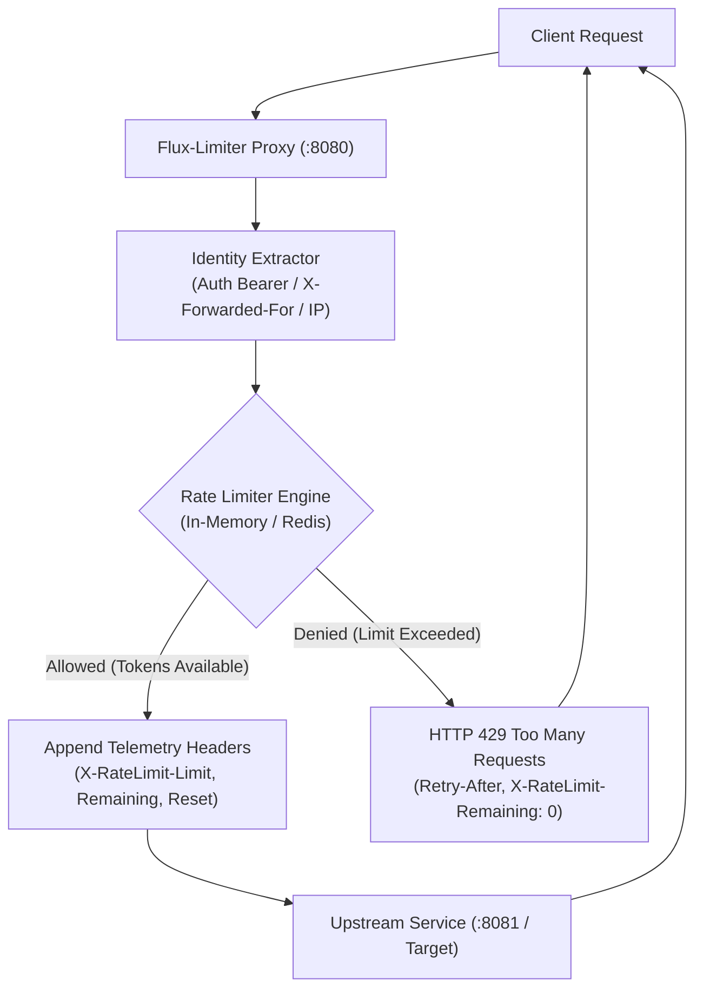

# Flux-Limiter

[](https://golang.org)
[](https://github.com/aqua-forte/flux-limiter)
[](https://goreportcard.com/report/github.com/aqua-forte/flux-limiter)
[](LICENSE)
[](Dockerfile)

**Flux-Limiter** is a blazing-fast, cloud-native distributed rate-limiting reverse proxy and Go middleware engine. Designed to protect mission-critical microservices and upstream APIs against traffic surges, credential stuffing, and denial-of-service attempts with sub-microsecond overhead.

---

## Architecture

Flux-Limiter operates transparently between incoming network ingress and upstream backend services. It evaluates client traffic identity (via API keys, JWT bearer tokens, `X-Forwarded-For`, or client IP) against either a high-concurrency in-memory Token Bucket engine or a distributed Redis cluster.



---

## Core Features

- **Dual Engine Architecture**:
  - **In-Memory Token Bucket**: High-concurrency sharded buckets with `sync.RWMutex` isolation and automatic background garbage collection of stale keys.
  - **Distributed Redis Engine**: Atomic Fixed Window and Sliding Window counters driven by single-roundtrip Lua scripts with zero race conditions.
- **Transparent Reverse Proxy**: Powered by `net/http/httputil.ReverseProxy`, ensuring streaming compatibility, header propagation, and minimal CPU footprint.
- **Rich Telemetry Headers**: Standardized RFC-compliant headers emitted on every request (`X-RateLimit-Limit`, `X-RateLimit-Remaining`, `X-RateLimit-Reset`, `Retry-After`).
- **Flexible Identity Resolution**: Automatic extraction from `Authorization` bearer tokens, `X-Forwarded-For` chains (leftmost true client IP), `X-Real-IP`, or TCP `RemoteAddr`.
- **Cloud-Native Resilience**: Built-in health probes (`/healthz`), configurable fail-open/fail-closed behaviors, upstream error handling (HTTP 502), and graceful shutdown on `SIGINT` / `SIGTERM`.

---

## Algorithm Comparison

| Feature | In-Memory Token Bucket | Distributed Redis (Sliding/Fixed) |
| :--- | :--- | :--- |
| **Primary Use Case** | Single-instance edge proxies, sidecars | Multi-replica Kubernetes clusters, gateways |
| **Burst Handling** | Supported natively (configurable capacity) | Controlled via sliding window granularity |
| **Storage Overhead** | Ephemeral RAM with background TTL eviction | Redis cluster memory with native key TTL |
| **Throughput** | **~56M+ ops/sec** (In-process sharding) | **100K - 1M+ ops/sec** (Network I/O bound) |
| **Data Consistency** | Node-local | Globally synchronized across all nodes |
| **Failure Mode** | Purely in-memory, zero network dependencies | Configurable `FailOpen` or `FailClosed` |

---

## Performance Benchmarks

Benchmarks were performed on Go 1.27 on an AMD Ryzen 7 7700 (8-Core, 16-Threads) architecture executing parallel goroutines (`b.RunParallel`):

```bash
go test -run=^$ -bench="." -benchmem ./limiter
```

```text
goos: windows
goarch: amd64
pkg: github.com/aqua-forte/flux-limiter/limiter
cpu: AMD Ryzen 7 7700 8-Core Processor
BenchmarkMemoryLimiter-16    69,123,627 ops    17.70 ns/op    0 B/op    0 allocs/op
```

### Benchmark Summary

| Benchmark Target | Throughput (RPS) | Latency | Memory Allocation | Allocs / Op |
| :--- | :--- | :--- | :--- | :--- |
| **MemoryLimiter (Token Bucket)** | **~56,497,000 req/sec** | **17.70 ns** | **0 B/op** | **0 allocs/op** |

> **Zero Allocations**: Memory access patterns in the fast path achieve **0 bytes allocated** and **0 heap allocations per operation**, preventing GC pauses under extreme load.

---

## Quick Start with Docker Compose

Spin up a complete end-to-end stack including `flux-limiter`, a `redis` cluster instance, and a mock upstream service with one command:

```bash
docker compose up -d
```

### Verify Normal Traffic (Within Quota)

```bash
curl -i http://localhost:8080/
```

**Response:**
```http
HTTP/1.1 200 OK
Content-Type: text/plain; charset=utf-8
X-RateLimit-Limit: 50
X-RateLimit-Remaining: 49
X-RateLimit-Reset: 0

Hello from upstream backend protected by flux-limiter!
```

### Verify Rate-Limited Traffic (Exceeded Quota)

When request quotas are exhausted, Flux-Limiter instantly rejects the request without forwarding it to upstream services:

```bash
for i in {1..60}; do curl -s -o /dev/null -w "%{http_code}\n" http://localhost:8080/; done
```

**HTTP 429 Response:**
```http
HTTP/1.1 429 Too Many Requests
Content-Type: application/json
Retry-After: 1
X-RateLimit-Limit: 50
X-RateLimit-Remaining: 0
X-RateLimit-Reset: 1

{
  "error": "too_many_requests",
  "message": "Rate limit exceeded. Please retry later.",
  "retry_after_seconds": 1
}
```

---

## Configuration Reference

Flux-Limiter is configured via standard environment variables:

| Variable | Type | Default | Description |
| :--- | :--- | :--- | :--- |
| `PORT` | string | `:8080` | Proxy server listening address and port |
| `TARGET_URL` | string | `http://localhost:8081` | Upstream backend URL to proxy allowed requests to |
| `LIMITER_TYPE` | string | `memory` | Rate limiting engine (`memory` or `redis`) |
| `RATE_LIMIT` | int64 | `100` | Allowed requests per window / tokens added per second |
| `BURST_LIMIT` | int64 | `100` | Maximum token burst capacity for in-memory Token Bucket |
| `WINDOW_DURATION` | duration | `1s` | Rate limit window duration (e.g. `1s`, `10s`, `1m`) |
| `KEY_EXTRACTOR` | string | `default` | Extraction strategy (`default`: Auth/XFF/IP, `ip`: IP-only) |
| `REDIS_ADDR` | string | `localhost:6379` | Redis host and port (when `LIMITER_TYPE=redis`) |
| `REDIS_PASSWORD` | string | `""` | Redis authentication password |
| `REDIS_DB` | int | `0` | Redis logical database index |
| `REDIS_ALGORITHM` | string | `fixed_window` | Redis algorithm (`fixed_window` or `sliding_window`) |
| `CLEANUP_INTERVAL` | duration | `1m` | Inactive key garbage collection frequency |
| `ENTRY_TTL` | duration | `3m` | Time-to-live before pruning inactive client buckets |

---

## Standalone Go Usage

Flux-Limiter modules can be embedded directly into custom Go HTTP services or API frameworks:

```go
package main

import (
	"context"
	"fmt"
	"log"
	"time"

	"github.com/aqua-forte/flux-limiter/limiter"
)

func main() {
	// Initialize in-memory token bucket: 100 req/sec with burst of 200
	lim := limiter.NewMemoryLimiter(100, 200, limiter.WithCleanupInterval(30*time.Second))
	defer lim.Close()

	ctx := context.Background()
	clientID := "client-api-key-xyz"

	res, err := lim.AllowDetailed(ctx, clientID)
	if err != nil {
		log.Fatalf("Rate limit check failed: %v", err)
	}

	if res.Allowed {
		fmt.Printf("Allowed! Remaining quota: %d\n", res.Remaining)
	} else {
		fmt.Printf("Rate limit exceeded! Retry after: %v\n", res.Reset)
	}
}
```

---

## Testing & Verification

Flux-Limiter is thoroughly covered by automated table-driven unit tests, concurrent benchmarks, and reverse proxy integration tests:

```bash
# Run all unit and integration tests with verbose logging
go test -v ./...

# Run concurrency benchmarks with memory allocation profiling
go test -run=^$ -bench="." -benchmem ./...
```

---

## License

This project is licensed under the MIT License — see the [LICENSE](LICENSE) file for details.
